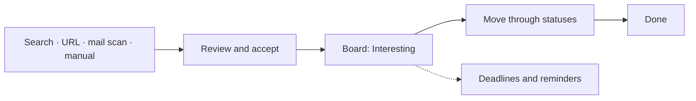
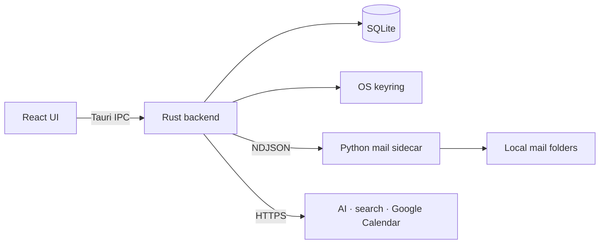

# Job Tracker

[](https://github.com/eikrad/Job-Tracker/actions/workflows/frontend.yml)
[](https://github.com/eikrad/Job-Tracker/actions/workflows/rust.yml)
[](https://github.com/eikrad/Job-Tracker/actions/workflows/python.yml)
[](https://github.com/eikrad/Job-Tracker)

A local-first desktop app for keeping track of your job applications, from the first
listing you find to the final answer.

Your jobs, documents and history live in a SQLite database on your own machine. There
is no account and no server; the app only goes online for the optional services you
switch on (AI extraction, job search, Google Calendar, mail scoring).

Built with **Tauri v2** (Rust), **React 19 + TypeScript** and **SQLite**. Runs on Linux,
Windows and macOS. The project is in **alpha**.

## Features

| Area | What you get |
|---|---|
| **Board** | Kanban (drag and drop), Table (sortable, custom columns, hidden statuses) and Calendar views; search by company or title; a Reminder Center for deadlines in the next 14 days |
| **Status pipeline** | Default `Interesting → Plan to Apply → Application Sent → Feedback → Done`; rename and reorder the columns in Settings. Every status change is recorded |
| **Job details** | Full edit form, contact and workplace fields, notes, attached PDFs (CV, cover letter, other), status timeline, and a one-click check whether the listing is still online |
| **Adding jobs** | Manual form, AI extraction from pasted listing text, Quick capture from a URL, and a Capture Inbox for links handed over from the browser |
| **Job search** | Searches Jobindex, Indeed, LinkedIn and The Hub with keywords taken from your saved jobs' tags (via SerpAPI, with Brave Search as fallback) |
| **Mail scan** | Reads job-alert mails from local Thunderbird folders (no IMAP, no login), scores each listing against your own CV text and queues good matches in the Mail Match Inbox. Nothing becomes a job until you accept it |
| **AI providers** | Scaleway DeepSeek (default), Google Gemini or Mistral, with your own API key |
| **Calendar** | Apply-by, interview and start dates on a month grid; optional push to Google Calendar |
| **Your data** | JSON/CSV export and import, automatic backup to a folder of your choice, API keys in the OS keyring, light and dark theme |

## How it works

You collect jobs from several places, review them, and move each one through your
pipeline:



Under the hood, the React UI talks only to the Rust backend. Rust owns the database,
the API keys and all network calls; a small Python sidecar parses local mail folders
and has no network access:



More detail: [docs/architecture.md](docs/architecture.md).

## Quick start

There are no prebuilt installers yet, so you build the app from source.

**Prerequisites:** Node.js 20+, Rust (stable), [uv](https://docs.astral.sh/uv/) (Python
tooling; runs the mail-scan sidecar in development), and the
[Tauri system packages](https://v2.tauri.app/start/prerequisites/) (WebKit + GTK on
Linux, C++ Build Tools on Windows). Per-OS install commands are in
[CONTRIBUTING.md](CONTRIBUTING.md#prerequisites).

```bash
git clone https://github.com/eikrad/Job-Tracker.git
cd Job-Tracker
npm ci
npm run tauri:dev
```

To build installers (`.deb`/`.rpm`, NSIS/MSI, `.app`/`.dmg`), run
`npm run tauri:build`, or `npm run tauri:build:release` to bundle the frozen mail-scan
sidecar so the target machine needs no Python. See
[Building installers](docs/user-guide.md#building-installers).

## Configuration

Everything is set up in the app under **Settings**. There is no `.env` file to edit;
[`fake.env`](fake.env) is only a placeholder that the app does not read.

| Setting | Needed for |
|---|---|
| AI provider and API key (Scaleway, Gemini or Mistral) | AI extraction. Mail scan always scores with the Scaleway key |
| SerpAPI and/or Brave Search key | Job search; SerpAPI is also used to check Indeed listings |
| Google OAuth Client ID (type *Desktop app*) | Creating events in Google Calendar |
| Mail folders and two Candidate Profiles (short and full CV text) | Mail scan |
| Backup folder | Automatic backup after every change (default `~/Jottacloud`) |

The core board works without any key. Step-by-step setup is in the
[user guide](docs/user-guide.md).

### Where your data lives

- **Database and PDFs:** the OS app-data folder, for example
  `~/.local/share/com.github.eikrad.jobtracker/` on Linux,
  `%APPDATA%\com.github.eikrad.jobtracker\` on Windows and
  `~/Library/Application Support/com.github.eikrad.jobtracker/` on macOS.
- **API keys and the Google refresh token:** the OS keyring, or a file readable only by
  you (`0600`) when no keyring is available. Keys are never sent back to the UI.
- **Candidate Profiles:** in the app-data folder with owner-only permissions; never
  exported or backed up.

## Development

| Command | Purpose |
|---|---|
| `npm run tauri:dev` | Full desktop app with database, keyring and native features |
| `npm run dev` | Browser-only UI preview (no database, no AI extraction) |
| `npm run verify` | Lint, tests and build for frontend, Rust and Python (also runs as the pre-commit hook) |
| `npm run test` | Frontend tests (Vitest) |
| `npm run py:test` | Python sidecar and contract tests (pytest, via uv) |
| `cargo test --manifest-path src-tauri/Cargo.toml` | Rust tests |

### Project structure

| Path | Contents |
|---|---|
| `src/` | React + TypeScript UI (`pages/`, `features/`, `components/`, `lib/`) |
| `src-tauri/` | Rust backend: Tauri commands, SQLite and migrations, LLM clients, job search, mail-scan orchestration, prompts |
| `python/mail_scan/` | Mail-scan sidecar: parses local mail folders, no network ([contract](python/README.md)) |
| `schemas/`, `tests/` | Sidecar event schema and its pytest contract tests |
| `scripts/` | Sidecar freeze, release build and Linux desktop-shortcut scripts |
| `docs/` | Documentation ([index](docs/README.md)) |

## Documentation

| Doc | What it covers |
|---|---|
| [docs/user-guide.md](docs/user-guide.md) | Using the app: setup, capture, search, calendar, mail scan, data, installers |
| [docs/architecture.md](docs/architecture.md) | How the code is organised, data flows, database tables |
| [docs/adr/](docs/adr/) | Architecture decision records |
| [CONTEXT.md](CONTEXT.md) | Glossary of domain terms |
| [CONTRIBUTING.md](CONTRIBUTING.md) | Build setup, checks, branches and pull requests |
| [docs/README.md](docs/README.md) | Index of all documentation |

## Contributing

Contributions are welcome. Pull requests target the `staging` branch and use
[Conventional Commits](https://www.conventionalcommits.org/); see
[CONTRIBUTING.md](CONTRIBUTING.md). If you fork the project, update the badge URLs and
the bundle identifier.

## License

Apache 2.0, see [LICENSE](LICENSE).
