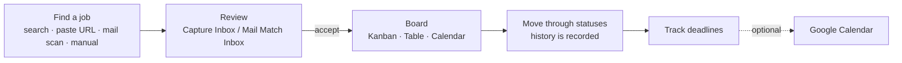
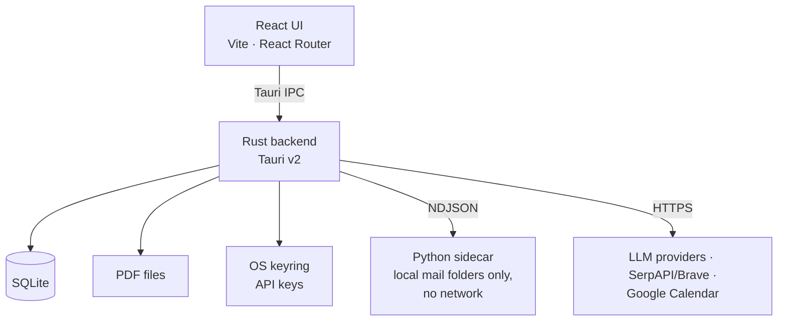

# Job Tracker

[](https://github.com/eikrad/Job-Tracker/actions/workflows/frontend.yml)
[](https://github.com/eikrad/Job-Tracker/actions/workflows/rust.yml)
[](https://github.com/eikrad/Job-Tracker/actions/workflows/python.yml)
[](https://github.com/eikrad/Job-Tracker)

A local-first desktop app that tracks job applications from discovery to outcome. Everything lives in a SQLite database on your machine; no cloud account is needed.

Built with **Tauri v2** (Rust), **React 19 + TypeScript** and **SQLite**.

## What it does

| Area | Highlights |
|---|---|
| **Board** | Kanban, Table and Calendar views of all applications; search by company/title; configurable status pipeline (default `Interesting → Plan to Apply → Application Sent → Feedback → Done`) |
| **Job detail** | Full edit form, PDF documents (CV, cover letter), status history timeline, one-click listing check (active / closed / archived / unreachable) |
| **Finding jobs** | In-app search of Jobindex, Indeed, LinkedIn and The Hub (SerpAPI, Brave Search as fallback); quick capture from a pasted URL; manual entry |
| **Mail scan** | Reads job-alert mails from your local Thunderbird folders (read-only, no IMAP), scores listings against your own Candidate Profiles and queues good ones in the Mail Match Inbox. Nothing is saved without your approval |
| **AI extraction** | Turns pasted listing text into job fields using Scaleway DeepSeek (default), Google Gemini or Mistral with your own key |
| **Deadlines** | Apply-by, interview and start dates, a Reminder Center, optional push to Google Calendar (OAuth PKCE, no client secret) |
| **Comfort and privacy** | Light/dark theme, JSON/CSV import and export, API keys in the OS keyring |

## How it works





Details: [docs/architecture.md](docs/architecture.md).

## Quick start

Prerequisites: **Node.js 20+**, **Rust** (stable), **[uv](https://docs.astral.sh/uv/)** (Python tooling and the mail-scan sidecar in dev), and the [Tauri system packages](https://v2.tauri.app/start/prerequisites/) (WebKit + GTK on Linux, C++ Build Tools on Windows). Per-OS install commands are in [CONTRIBUTING.md](CONTRIBUTING.md#prerequisites).

```bash
git clone https://github.com/eikrad/Job-Tracker.git
cd Job-Tracker
npm ci
npm run tauri:dev     # full desktop app
```

| Command | Purpose |
|---|---|
| `npm run tauri:dev` | Desktop app with database, keyring and native features |
| `npm run dev` | Browser-only UI preview (no database, no AI extraction) |
| `npm run tauri:build` | Release build and installers (`.deb`/`.rpm`, NSIS/MSI, `.app`/`.dmg`) |
| `npm run tauri:build:release` | Release build with the frozen mail-scan sidecar (no Python needed on the target machine) |
| `npm run verify` | Lint, tests and build for frontend, Rust and Python (also the pre-commit hook) |

## Configuration

Open **Settings** in the app. There is no `.env` to edit: [`fake.env`](fake.env) is only a placeholder and the app does not read it.

| Setting | Needed for |
|---|---|
| AI provider and API key (Scaleway, Gemini or Mistral) | AI extraction; Mail scan always uses the Scaleway key |
| SerpAPI key and/or Brave Search key | In-app job search and listing check |
| Google OAuth Client ID (Desktop app type) | Pushing events to Google Calendar |
| Mail folders and Candidate Profiles | Mail scan |

Keys are stored in the OS keyring (falling back to a `0600` file) and are never sent to the web view. Step-by-step setup is in the [user guide](docs/user-guide.md).

## Tech stack

| Layer | Technology |
|---|---|
| UI | React 19, TypeScript, Vite, React Router v7, dnd-kit |
| Desktop shell | Tauri v2 (Rust) |
| Database | SQLite via rusqlite |
| AI | Scaleway DeepSeek (default), Gemini, Mistral; calls made from Rust |
| Search | SerpAPI, Brave Search API |
| Mail scan | Python sidecar (`python/mail_scan`) driven over NDJSON |
| Calendar | Google Calendar API, OAuth 2 PKCE |
| Tests and CI | Vitest, cargo test/clippy, pytest, ruff, black, isort; GitHub Actions |

## Documentation

| Doc | What it covers |
|---|---|
| [docs/README.md](docs/README.md) | Index of all documentation |
| [docs/user-guide.md](docs/user-guide.md) | Configuration, job search, Google Calendar, mail scan, data storage, installers |
| [docs/architecture.md](docs/architecture.md) | Structure, data flows, SQLite tables, mail scan pipeline |
| [docs/adr/](docs/adr/) | Architecture decision records |
| [CONTEXT.md](CONTEXT.md) | Domain glossary |
| [CONTRIBUTING.md](CONTRIBUTING.md) | Build setup, checks, branches and pull requests |
| [docs/maintenance.md](docs/maintenance.md), [docs/releasing.md](docs/releasing.md) | Dependency upkeep and release process |

## Contributing

Pull requests target the `staging` branch and use Conventional Commits; see [CONTRIBUTING.md](CONTRIBUTING.md). After `npm ci`, a pre-commit hook runs `npm run verify` so local commits match CI. If you fork, update the badge URLs above.

## License

Apache 2.0 — see [LICENSE](LICENSE).
