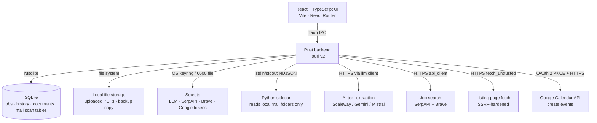
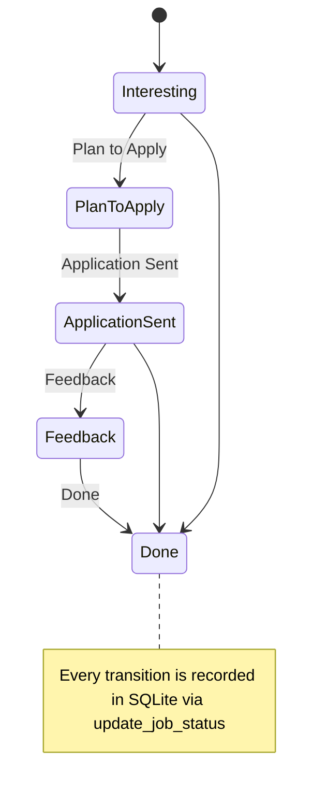
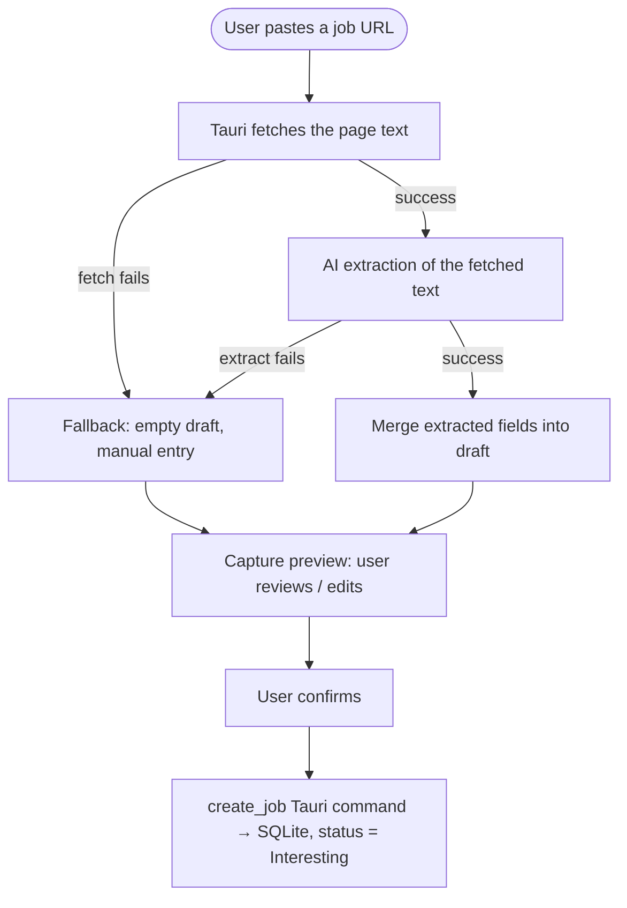
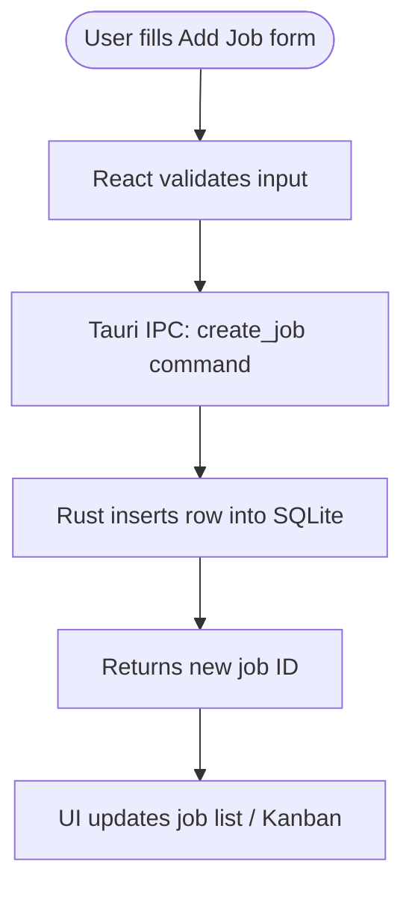
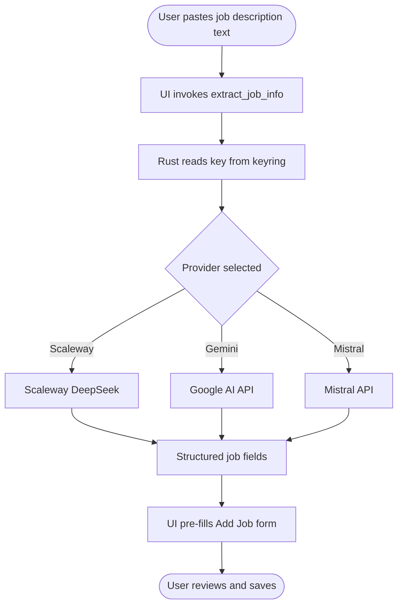
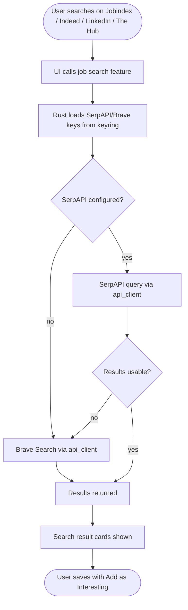
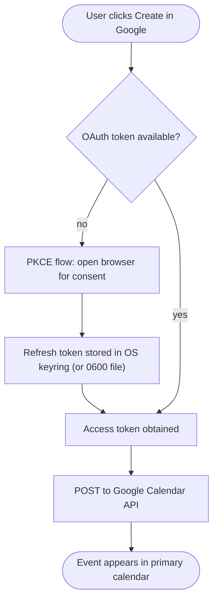
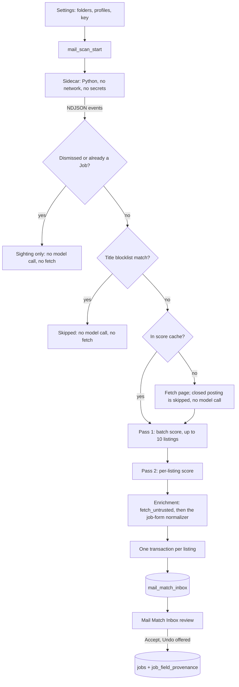

# Job Tracker — Architecture

This document describes how Job Tracker is built — from the desktop shell to the database, and how the optional AI and calendar integrations fit in.

---

## Overview

Job Tracker is a desktop application built with **Tauri v2** (Rust native shell) and a **React + TypeScript** UI. All data is stored locally: jobs, PDFs, and settings live in an OS-managed SQLite database and file directory — no cloud account required to use the core app. The webview never sees an API key and never makes an outbound request itself; every network call is made from Rust.



---

## Tech Stack

| Layer | Technology |
|---|---|
| UI framework | React 19 + TypeScript + Vite |
| Routing | React Router v7 |
| Desktop shell | Tauri v2 (Rust) |
| Database | SQLite via rusqlite |
| Drag-and-drop | dnd-kit |
| AI extraction | Scaleway DeepSeek (default), Google Gemini, Mistral — keys in OS keyring; calls in Rust |
| Job search & listing check | SerpAPI (primary) + Brave Search API (fallback); listing URLs via `fetch_untrusted` |
| Calendar | Google Calendar API (OAuth 2 PKCE, desktop flow) |
| Theme | "Breath" light/dark palette (KDE/Manjaro); OS-aware via `prefers-color-scheme`, togglable in the header (`src/lib/theme.ts`, `src/hooks/useTheme.ts`) |
| Mail-scan sidecar | Python 3.12 (`python/mail_scan`), no network; frozen with PyInstaller for release builds |
| Testing | Vitest (frontend), cargo test (Rust), pytest (Python sidecar and contract tests) |
| Linting | ESLint, TypeScript, cargo clippy, Ruff, Black, isort |

---

## Source Structure

```
src/                    — React + TypeScript UI
  features/             — Feature-scoped modules
    capture/            — Paste-URL capture: fetch listing text, AI-extract, and triage in a Capture Inbox (+ browser handoff link)
    deadlines/          — Deadline tracking logic
    extraction/         — AI text extraction (invokes Rust; normalizes fields in TS)
    jobSearch/          — Job search UI (keys stay in keyring)
    jobs/                — Core job CRUD and state
    mailMatch/           — Mail Match Inbox: view logic, run reducer, panel (separate from capture/, ADR 0003)
    reminders/           — Reminder support
  components/           — Shared UI components
  context/              — React context providers (global app state)
  hooks/                — Shared custom hooks (incl. useTheme — Breath light/dark theme)
  i18n/                 — Internationalisation strings
  lib/                  — Utilities: tauriApi.ts (typed wrappers for every Tauri command), types.ts, theme.ts, statusUtils.ts
    jobs/               — Dashboard/table helpers (sortJobs, filterJobs, boardViewPreference, jobTableColumns, hiddenJobStatuses, duplicateCheck)
    calendar/           — Calendar occurrences of job dates and Google Calendar template/event links
    db/                 — Column list mirroring the SQLite `jobs` schema (documentation/typing only)
    export/             — JSON/CSV export and import parsing
    secrets/            — One-time migration of old localStorage keys into the keyring
    storage/            — Safe localStorage preference helpers
  pages/                — Route-level page components: Dashboard, Add Job, Job Detail (`/job/:id`), Job Search, Mail Matches (`/mail-matches`)
src-tauri/              — Rust / Tauri backend
  src/                  — Tauri commands (registered in lib.rs)
    db.rs               — Job CRUD, status history, documents, import, backup
    migrations.rs       — Versioned SQLite migrations (PRAGMA user_version)
    secrets.rs          — Keyring store with 0600-file fallback, redaction
    net.rs              — fetch_untrusted (SSRF-hardened) and api_client
    job_search.rs       — SerpAPI/Brave job search, keyword stats, page-text fetch
    listing_check.rs    — "Is this listing still online?" classifier
    calendar.rs, google_oauth.rs — Google Calendar events and the OAuth PKCE flow
    ipc_responsiveness.rs — Test guard: slow commands must not block the IPC thread
    llm/                — Provider registry, endpoint/model overrides, shared chat transport (retry/classification), normalizer
    mail_scan/          — Sidecar orchestration, scoring, enrichment, accept, inbox queries, settings
  prompts/              — Prompt templates and JSON schemas (extraction, scoring, digest split)
  fixtures/             — Listing-status classifier baseline (`listing_status_baseline.json`)
  binaries/             — Frozen mail-scan sidecar for release builds (gitignored)
  capabilities/         — Tauri permission declarations
python/                 — Mail-scan sidecar (no network, no secrets — ADR 0004)
schemas/                — JSON Schema of the sidecar's NDJSON event stream
docs/                   — Documentation (index: docs/README.md)
scripts/                — Build and tooling scripts (sidecar freeze, release build, desktop shortcut)
tests/                  — Python contract tests for the sidecar and export schema (pytest)
.github/                — CI workflows and Dependabot config
storage/                — Optional manual file storage (gitignored)
```

---

## Key Data Flows

### Application status flow

Each job moves through a Kanban pipeline (columns are user-renameable in Settings; defaults shown). Every status change is written to a status-history table for the job's timeline view.



### Capture workflow (paste a URL)

Lets a user paste a job listing URL and get a pre-filled draft without manual data entry. Implemented in `src/features/capture/` and the `QuickCaptureDrawer`.



The **capture inbox** (`captureInbox.ts`) queues browser-originated URLs client-side (browser `localStorage`); there is currently no Tauri/Rust backend command for it, so queued items do not sync across devices or survive a data wipe. A URL can also be queued from outside the app via a copyable handoff link (`?capture_url=<url>`, e.g. from a browser bookmarklet); the app enqueues it into the same Capture Inbox on next load (see `App.tsx`).

### Adding a job manually



### AI-assisted extraction

Job-form **Extract** calls the Tauri command `extract_job_info`. Rust loads the selected provider’s key from the OS keyring (or `0600` file fallback), calls Scaleway / Gemini / Mistral, and returns structured fields. Default models come from the registry in `src-tauri/src/llm/provider.rs`; Settings can override a provider's base URL and model id (`llm_provider_overrides.json` in app data), and **Test connection** (`llm_test_connection`) checks the selected provider. The webview never sees the key. Browser-only `npm run dev` cannot extract — use `npm run tauri:dev`.



`priority` is never taken from model output (manual only).

### Outbound HTTP helpers

| Helper | Use when | Guards |
|--------|----------|--------|
| `net::fetch_untrusted` | Attacker-influenced listing / enrichment URLs | http(s) only; reject private/loopback IPs; re-check after each redirect; 2 MiB body cap; text/HTML/JSON content types; no auth |
| `net::api_client` | Hardcoded SerpAPI / Brave hosts | Host allowlist; auth headers allowed |

### Job search



### Listing status check

A one-click freshness check per saved job, implemented in `src-tauri/src/listing_check.rs` (`check_listing_status` command) and surfaced by the **Check listing** button in the dashboard's detail panel (`JobDetailTimeline.tsx`) and on the job detail page (`JobDetailPage.tsx`). Rust fetches the job's stored URL via `fetch_untrusted` and classifies it as `active`, `closed`, `archived`, or `unreachable`; for sources that block automated requests (e.g. Indeed), it instead resolves the listing via SerpAPI (`api_client`). The result and timestamp are written to the `jobs.listing_status` / `jobs.listing_checked_at` columns.

Classifier outcomes for representative boards are pinned in `src-tauri/fixtures/listing_status_baseline.json` (exercised by `listing_check` tests) so SSRF body/type caps cannot silently change status heuristics.

### Google Calendar event creation



---

## Data Storage

All data lives in the OS app data directory (`$APPDATA` below; Tauri's `app_data_dir()` for the identifier `com.github.eikrad.jobtracker`, e.g. `~/.local/share/com.github.eikrad.jobtracker/` on Linux) — nothing is stored in the repo.

| What | Where | Managed by |
|---|---|---|
| Jobs, status history, documents metadata, mail scan state | SQLite `$APPDATA/data/app.db` (tables below) | Rust via rusqlite, migrations in `migrations.rs` |
| Uploaded PDFs | `$APPDATA/storage/applications/` | Rust file commands (`db.rs`) |
| API keys (AI, search), Google OAuth refresh token, manual Google access token | OS keyring (fallback: `0600` files in `$APPDATA/secrets/`) | Rust `secrets` module; Settings shows configured / Replace / Remove only |
| Google OAuth Client ID | `$APPDATA/google_oauth_client_id.txt` (not a secret) | `google_oauth.rs` |
| LLM base URL / model id overrides | `$APPDATA/llm_provider_overrides.json` | `llm/overrides.rs` |
| Mail scan settings (folders, cutoff, look-back days, call budget, title blocklist) | `$APPDATA/mail_scan_settings.json` | `mail_scan/settings.rs` |
| Candidate Profiles | `$APPDATA/profiles/{short,full}.md`, mode `0600`; never exported or backed up | `mail_scan/profiles.rs` |
| LLM provider choice, board column names (`statuses`), backup folder, theme, default board view, table columns/hidden statuses, header search text | Browser local storage (names only, never keys) | React UI |
| Capture Inbox queue | Browser local storage | `src/features/capture/captureInbox.ts` |

### Automatic backup

After the main job edits made from the UI (create, edit, status change, delete, import, PDF upload on the job detail page), `runBackup` in `useJobTrackerState.ts` calls the `backup_to_folder` command if **Settings → Backup & restore → Backup folder path** is non-empty (default `~/Jottacloud`). Rust writes `<folder>/JobTracker/app.db` with `VACUUM INTO` (a single consistent file, safe under WAL) and copies `storage/applications/` next to it. Only the allowlisted `BACKED_UP_SUBDIRS` are copied, so Candidate Profiles and secrets are never part of a backup. Failures are logged to the console, not shown. Accepting a Mail Match does not trigger a backup; the next edit does.

### SQLite tables

| Table | Purpose |
|---|---|
| `jobs` | One row per application — company, title, dates, contact, salary, status, etc. |
| `status_history` | Audit trail of `from_status` → `to_status` changes, written automatically on every status update |
| `job_documents` | One row per attached PDF (CV, cover letter, other), linked to a job |
| `job_field_provenance` | Which fields a mail scan wrote, and in which run — answers "where did this deadline come from?" |
| `mail_scan_runs` | One row per scan, with `stats_json` counters the History view renders |
| `mail_fingerprints` / `mail_fingerprint_aliases` | Tiered listing identity, stable across runs (spec §5.1) |
| `mail_match_inbox` | Pending / accepted / dismissed matches awaiting review (`kind` and `base_job_updated_at` are leftovers of the retired update suggestions; `kind` is always `new`) |
| `mail_match_dismissals` | Revocable suppressions, with reason and originating run |
| `mail_digest_splits` | Cached model splits of Digest mails into listings |
| `mail_scored_sightings` | Score cache and re-score policy, keyed by content + profile + prompt + model |
| `mail_source_cursors` | Per-folder incremental read position, so a 200 MB folder is not re-read |

### Mail scan



Properties worth knowing before changing any of it:

- **No path from model output to a written Job.** A score can only put a row in front
  of a human. `priority` and `status` are never written from a scan.
- **Per-listing transactions.** A crash at listing 60 of 118 leaves 59 usable rows.
- **Two cache lookups, deliberately different.** The exact 5-tuple lookup makes a re-run
  free; the model-blind lookup stops a provider switch from re-spending the backlog.
  Only a profile edit or a prompt change re-scores.
- **A scan never writes onto an existing Job.** A listing that is already a Job (its
  fingerprint was accepted, or a Job carries its link as `url` or `board_url`) is
  recorded as a sighting and kept out of the inbox; the run summary counts it as
  "already on your board".
- **Known listings cost nothing.** `persist::gate_listing` runs before a listing joins
  a pass-1 batch: dismissed and already-tracked listings never reach the model or the
  network. `persist_listing` re-checks after enrichment only for the case the gate
  cannot see — the employer ad a board link led to is already a Job's `url`.
- **A closed posting costs one fetch, never a model call.** A listing the score cache
  does not know has its page fetched before scoring (`ScoringEngine::precheck`), and
  `listing_check::is_confidently_closed` drops it on a gone status, a redirect up the
  path, or an explicit closed phrase. The live page is handed on to enrichment, so no
  listing is fetched twice. Cached listings skip the check (scoring them is free); if
  one reaches the inbox, enrichment catches the closing instead.
- **The title blocklist runs before anything that costs.** `title_filter` matches
  whole words, case-insensitive, with `*` at an entry's start or end for compounds.
- **The inbox is read, not rendered.** The row detail shows the draft's full
  `raw_text` as plain text, the latest pass-1 and pass-2 reasons (joined from
  `mail_scored_sightings`), and the ad and Board Link opened through
  `open_url_in_browser`. `snippetOnly` on a row is derived from the stored
  enrichment reason, so Indeed rows read "Mail snippet only" without a migration.
- **Secrets and CV content stay in Rust.** Neither crosses the IPC boundary.

---

## Dashboard Views

The **Dashboard** is the home screen and supports three view modes:

| View | Description |
|---|---|
| Kanban | Drag-and-drop columns by application status |
| Table | Sortable / filterable list of all jobs, with a **Customize** panel for column visibility and hidden statuses |
| Calendar | Month grid showing apply-by, interview, and start dates |

The view shown on load is set by **Settings → Default board view** (`kanban` / `table` / `calendar`, default `table`), persisted in local storage via `src/lib/jobs/boardViewPreference.ts`.

The header's search box (`en.app.jobSearchLabel`) filters the dashboard by company or title across all three views — implemented in `src/lib/jobs/filterJobs.ts` (`filterJobsBySearch`) and wired through `useJobTrackerState.ts` / `DashboardPage.tsx`. Its query text persists in local storage (`src/lib/jobs/jobSearchQuery.ts`).

The Table view's **Customize** toggle (`src/features/jobs/JobTable.tsx`) opens a panel with two checkbox groups:
- **Columns** — show/hide any of the nine table columns (at least one must stay visible); selection persists via `src/lib/jobs/jobTableColumns.ts`.
- **Hide statuses** — exclude one or more pipeline statuses from the table; persists via `src/lib/jobs/hiddenJobStatuses.ts` and applies only to the Table view.

Selecting a job opens a detail panel beside the board (`src/features/jobs/JobDetailTimeline.tsx`) with a summary (status, priority, dates, tags, notes), the listing check and delete; **Full details** opens the job detail page.

Alongside the three views, a **Reminder Center** panel (`src/features/reminders/ReminderCenter.tsx`) lists jobs with a deadline in the next 14 days (or overdue), excluding jobs already in a `Done` status.

### Status workflow

The default board pipeline (`DEFAULT_STATUSES` in `src/lib/types.ts`) is:

```
Interesting → Plan to Apply → Application Sent → Feedback → Done
```

This is a configurable default, not a fixed enum — column names can be renamed in Settings. Every status change is recorded in `status_history` with a timestamp and shown as a timeline on the job detail page.

### Job detail page

Each job has a dedicated page at `/job/:id` (`src/pages/JobDetailPage.tsx`) with the full edit form, per-job document upload/management, and the status-change timeline described above.

---

## CI

Three independent check workflows (Frontend, Rust, Python) run on every push and pull request, plus a scheduled security audit. Three more workflows handle repository rules and releases: `commit-messages.yml`, `protect-main.yml` and `release-please.yml` (see [releasing.md](releasing.md)).

| Workflow | Checks |
|---|---|
| **Frontend** | ESLint → Vitest → `tsc -b && vite build` |
| **Rust** | `cargo clippy` → `cargo test` |
| **Python** | `ruff check` → `black --check` → `isort --check-only` → `pytest` |
| **Weekly Security Audit** (`weekly-audit.yml`) | Scheduled (Mondays) `npm audit` + `pip-audit` + `cargo-audit`; opens/updates a GitHub issue when vulnerabilities are found — see `docs/maintenance.md` for audit history |

A pre-commit hook (installed by `npm ci`) runs `npm run verify` locally before every commit so CI failures are caught early. Locally this uses **uv** to manage the Python environment (`pyproject.toml` / `uv.lock`); CI's `python.yml` instead installs from `requirements-dev.txt` via pip.
